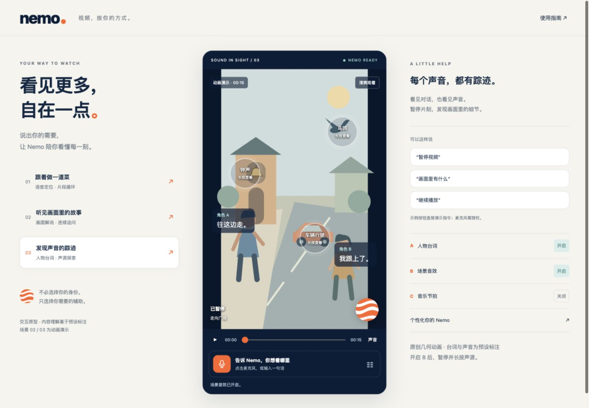

# Nemo · Understand Videos Your Way

An interactive HCI prototype that you can download and run on your own computer. Use voice or text to find video segments, repeat cooking steps, and explore scene descriptions. Combine captions, sound-source cues, and visual beat feedback to suit your preferences.



## Download and Run

No domain name or cloud server is required. Each user runs a local copy on their own computer.

1. Select **Code → Download ZIP** on this GitHub repository and extract the entire archive. Alternatively, clone the repository with `git clone https://github.com/QiumanZeng/Nemo.git`.
2. Install **Python 3.9 or later**. No additional Python packages are needed.
3. Open a terminal in the extracted project folder and run:

   ```sh
   # macOS / Linux
   python3 serve.py --open
   ```

   ```powershell
   # Windows
   py -3 serve.py --open
   ```

4. Your browser will open **http://127.0.0.1:8767/**. Keep the terminal open while using the prototype. Press `Ctrl+C` to stop the server.

Launcher scripts are also provided: `start.command` for macOS and `start.bat` for Windows. If your system blocks double-click execution, use the terminal commands above; there is no need to change your system's security settings.

If the port is already in use, run `python3 serve.py --port 8768 --open` (use `py -3` on Windows). Start the local server instead of opening `dist/index.html` directly: the server provides a consistent origin for video seeking, settings synchronization, and browser permissions.

**Here, `127.0.0.1` refers to each user's own computer, not the developer's Mac.** After downloading the project, everyone can run their own copy. The local page is available while that copy's server is running. Stopping your server does not affect anyone else's copy.

## Three Experiences

The current interface and command recognition use Chinese. The examples below retain the supported commands, with English translations for reference. You can also click the example buttons in the interface.

| Scenario | Actions | Result |
| --- | --- | --- |
| Cook along | “回到打蛋，循环这一步” (go back to beating the eggs and loop this step) → “下一步” (next step) → “继续播放” (resume playback) | Seek within the cooking video, loop a segment, move to the next step, and exit the loop. |
| Listen to the story | “画面里有什么” (what is in the scene?) → “为什么好笑” (why is it funny?) → “继续播放” (resume playback) | Pause the animation, receive a scripted description and follow-up answer, then resume playback. |
| Discover sound sources | Select the Nemo orb → enable B → pause → press and hold a sound source | Display a sound source and its explanation. You can also open the explanation with Enter or Space on the keyboard. |

Open **Nemo orb → Quick Settings → All Settings** to adjust caption layout, text size, theme, and other preferences. Settings are stored in each user's browser and are not shared with other computers.

## Voice Input and Offline Use

- Microphone permission is requested only when you select the microphone. By default, say “嘿 Nemo” (Hey Nemo) before giving a command.
- Speech recognition depends on browser support, device permissions, and network services. Your browser may process speech online; Nemo does not store recordings.
- Listening stops when you turn off the microphone, open settings, switch scenes, or move the page to the background. It also times out when no input is received.
- You can complete the demonstration without a microphone by typing commands or selecting the example buttons.
- The webpage, video, and scripted animations are included in the repository and can run locally after download. Offline speech recognition is not guaranteed.

## Prototype Scope

**Implemented functionality:** video playback, segment seeking and looping, coordinated settings, caption and sound-source interactions, themes, and locally saved preferences.

**Scripted demonstrations:** video understanding, scene questions and answers, captions, sound positions, and beat feedback. The cooking video's text consists of manually written action cues, not a full transcript. The other two scenes are geometric animations without actual audio tracks. The prototype does not include a general-purpose AI backend, physical haptic feedback, account synchronization, or automatic learning.

The cooking video is a web-compressed version of approximately 20 MB that retains the full duration. Video chunks are stored in `media/cooking/`. On first launch, the server automatically verifies and reassembles them into the playback directory; no separate download is needed. Download the entire repository. See [Design and Limitations](docs/DESIGN_AND_LIMITATIONS.md) for further details and [ATTRIBUTION.md](ATTRIBUTION.md) for asset credits.

## Project Structure

```text
nemo/
├── dist/                 Webpage, styles, scripts, settings, and video
├── docs/                 Design notes and screenshots
├── tests/                Command-matching tests
├── serve.py              Local server with video Range request support
├── start.command         macOS launcher
├── start.bat             Windows launcher
└── ATTRIBUTION.md        Asset sources and usage scope
```

The frontend uses plain HTML, CSS, and JavaScript. Running the prototype requires neither Node.js nor an API key. Developers can run the command-matching tests with Node.js:

```sh
node --test tests/core.test.cjs
```

The repository is public for convenient viewing and downloading. Public availability does not imply that the third-party video or all source code is covered by an open-source license. Please refer to the attribution document.
